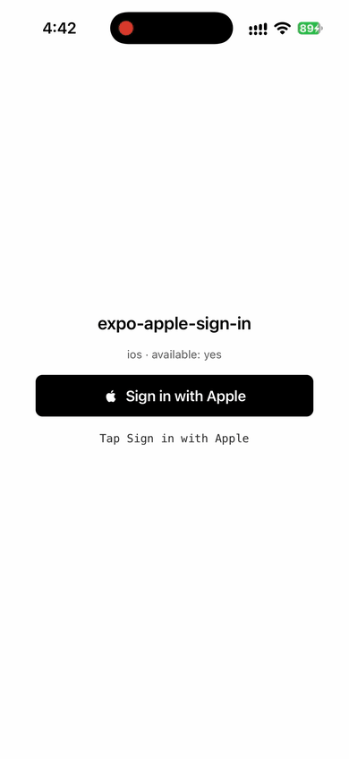
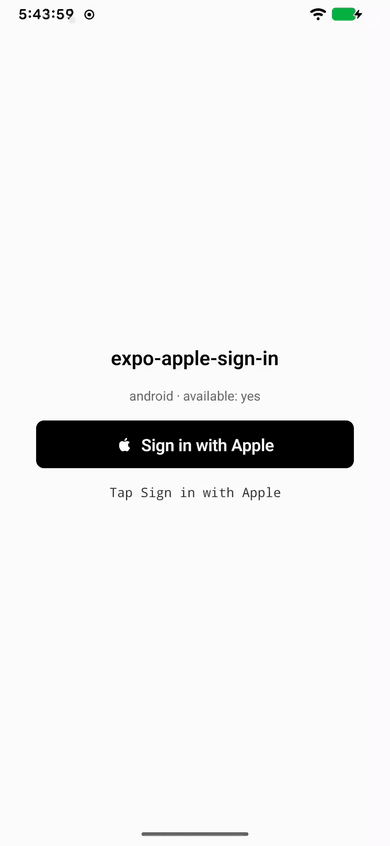
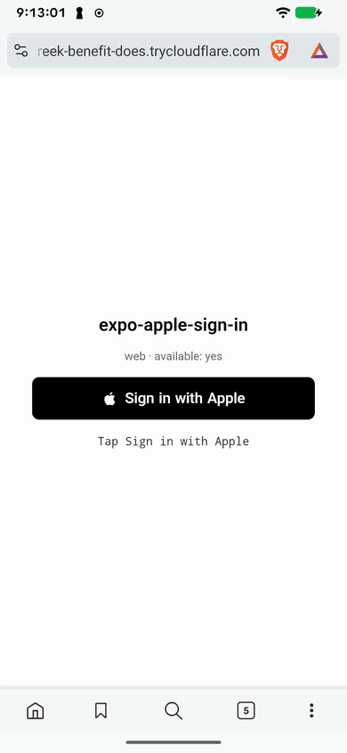

<p align="center">
  <picture>
    <source media="(prefers-color-scheme: dark)" srcset="docs/public/logo-dark.svg">
    
  </picture>
</p>

<h1 align="center">expo-apple-sign-in</h1>

<p align="center">
  <strong>Sign in with Apple for Expo SDK 58.</strong><br />
  One API and one Apple-style button for iOS, Android and web, with adapters for Supabase, Clerk and Firebase
</p>

<p align="center">
  <a href="https://www.npmjs.com/package/expo-apple-sign-in"></a>
  <a href="https://skills.sh/smartsquad/expo-apple-sign-in"></a>
  <a href="LICENSE"></a>
  <a href="https://expo.dev/"></a>
  
</p>

<p align="center">
  <a href="https://exsi.smartsquad.io/">Documentation</a> ·
  <a href="https://exsi.smartsquad.io/getting-started/quick-start.html">Quick start</a> ·
  <a href="#demo">Demo</a> ·
  <a href="https://exsi.smartsquad.io/providers/supabase.html">Providers</a> ·
  <a href="https://exsi.smartsquad.io/comparison.html">Comparison</a> ·
  <a href="https://github.com/smartsquad/expo-apple-sign-in/blob/main/CHANGELOG.md">Changelog</a>
</p>

<p align="center">
  
</p>

---

> [!IMPORTANT]
> **Expo SDK 58 only.** The native code is written with Expo Modules 2.0 (`@ExpoModule` and `@JS`), which earlier SDKs do not support. Expo Go cannot load the native module, so iOS and Android need a development build.

## Install

```bash
npx expo install expo-apple-sign-in
```

Add the config plugin to `app.json`, then build a development client. The plugin enables the Sign in with Apple entitlement for iOS and sets `CFBundleAllowMixedLocalizations` to `true` unless your app already defines it, so the Apple sheet follows the device language.

```json
{
  "expo": {
    "plugins": ["expo-apple-sign-in"]
  }
}
```

```bash
npx expo prebuild
npx expo run:ios
```

## Quick start

On iOS the library signs in with your app's App ID, so it needs no configuration. Android and web open Apple's web flow, which needs a Services ID and an HTTPS Return URL registered in the Apple Developer portal. Pass both to `AppleAuth.configure` once, then render `AppleButton`:

```tsx
import { useState, type ReactElement } from 'react'
import { Text, View } from 'react-native'
import { AppleAuth, AppleButton } from 'expo-apple-sign-in'

AppleAuth.configure({
  clientId: 'com.example.app.web',
  redirectUri: 'https://app.example.com/auth/callback',
})

export default function App(): ReactElement {
  const [status, setStatus] = useState('Signed out')

  return (
    <View style={{ flex: 1, justifyContent: 'center', gap: 16, padding: 24 }}>
      <AppleButton
        buttonStyle="black"
        buttonType="signIn"
        onSuccess={(credential) => setStatus(`Apple user ${credential.user.id ?? 'unknown'}`)}
        onCancel={() => setStatus('Canceled')}
        onError={(error) => setStatus(`Sign-in failed: ${error.code}`)}
      />
      <Text>{status}</Text>
    </View>
  )
}
```

`AppleAuth.signIn()`, which the button calls, returns the same credential on every platform. It hashes the nonce with SHA-256 before sending it to Apple and puts the raw nonce on `credential.nonce`, which is the value Supabase and Firebase check against the identity token. Do not hash it again.

## Demo

The [`example`](example/) folder is a single-screen Expo SDK 58 app that installs this package from the parent folder (`file:..`) and shows `AppleButton`. iOS and Android need a development build. Expo Go cannot load the native module.

From the repository root:

```bash
npm install
cd example
npm install
npx expo run:ios
```

`npx expo run:ios` compiles the development client and opens it on a simulator or a device. Android is the same kind of build:

```bash
npx expo run:android
```

Web does not need a native build. From `example/`:

```bash
npx expo start --web --port 43180 --host lan
```

That dev server can only do popup sign-in. To try the redirect mode as well, run `npm run build` at the repository root, then `npm run web:serve` in `example/`. Web sign-in needs an HTTPS host that Apple accepts, such as a tunnel, and the [local testing guide](https://exsi.smartsquad.io/guides/local-testing.html) walks through it.

Android and web read `EXPO_PUBLIC_APPLE_SERVICE_ID` and `EXPO_PUBLIC_APPLE_REDIRECT_URI`, either exported in the shell or written in `example/.env`. iOS signs in with the app's App ID. Set `ios.bundleIdentifier` in `example/app.json` to an App ID that has Sign in with Apple enabled, then rebuild. The same steps are on the [demo page](https://exsi.smartsquad.io/examples.html).

<p align="center">
  
  
  
</p>

The web recording shows Brave on Android with the redirect mode.

## Providers

Each adapter runs Sign in with Apple and hands the result to your auth service in one call:

- [Supabase](https://exsi.smartsquad.io/providers/supabase.html): `signInWithSupabase(supabase)` from `expo-apple-sign-in/supabase` calls `signInWithIdToken` with the identity token and the raw nonce.
- [Clerk](https://exsi.smartsquad.io/providers/clerk.html): `signInWithClerk({ signIn, signUp, setActive })` from `expo-apple-sign-in/clerk` sends the identity token with the `oauth_token_apple` strategy and follows Clerk's transfer step when the Apple Account already has a Clerk user.
- [Firebase](https://exsi.smartsquad.io/providers/firebase.html): `signInWithFirebase(signInWithCredential)` from `expo-apple-sign-in/firebase` passes the identity token and the raw nonce to your Firebase sign-in function.

## Why this package

Sign in with Apple works differently on each platform: iOS shows a native sheet, while Android and web have to go through Apple's web flow with a Services ID. This package puts those paths behind one call and one credential shape, so the code that talks to your backend is the same on iOS, Android and web. It also handles the nonce for you and ships adapters for the three common auth providers. The [comparison](https://exsi.smartsquad.io/comparison.html) shows how it relates to other Sign in with Apple packages for React Native and Expo.

Google Sign-In is not this package. [react-native-nitro-google-signin](https://react-native-nitro-google-sign-in.github.io/) is the library to use for that, on Android Credential Manager and on iOS. If the app needs Sign in with Apple and cannot take Expo SDK 58, [@invertase/react-native-apple-authentication](https://github.com/invertase/react-native-apple-authentication) is the one to use, including its Android module. Both are good libraries.

## Agent skill

The repository ships an Agent Skill that teaches coding agents the `expo-apple-sign-in` API, the nonce rule, the Apple Developer setup for each platform, and the Supabase, Clerk, and Firebase adapters. Install it with the `skills` CLI:

```bash
npx skills add smartsquad/expo-apple-sign-in
```

Add `-g` for a user-level install, or `-a claude-code` (or another agent) to target one agent. The [agent skill page](https://exsi.smartsquad.io/agents/skill.html) lists what the skill covers.

## Documentation

The [documentation site](https://exsi.smartsquad.io/) covers [requirements](https://exsi.smartsquad.io/getting-started/requirements.html), the [Apple Developer setup](https://exsi.smartsquad.io/setup/apple-developer.html) for each platform, [usage](https://exsi.smartsquad.io/guides/usage.html), [backend verification](https://exsi.smartsquad.io/guides/backend.html), the [API reference](https://exsi.smartsquad.io/reference/api.html) and [troubleshooting](https://exsi.smartsquad.io/reference/troubleshooting.html). The [demo](#demo) runs the same sign-in screen from [`example/`](example/).

## Contributing

[CONTRIBUTING.md](CONTRIBUTING.md) describes the change workflow. Run these checks before you open a pull request, because CI runs the same five on every pull request into `main`:

```bash
npm test
npm run typecheck
npm run lint
npm run build
npm run docs:build
```

CI runs ESLint with `--max-warnings 0`, so a single warning fails the pull request. For questions, read [SUPPORT.md](SUPPORT.md). Report a vulnerability by email as [SECURITY.md](SECURITY.md) describes, never in a public issue. Everyone who takes part in the project follows the [code of conduct](CODE_OF_CONDUCT.md).

## License

[MIT](LICENSE), copyright Smart Squad Srl.
